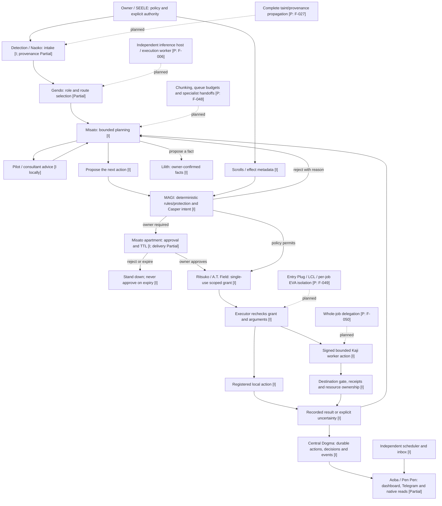

# NERV target schema

Corrected on 8 November 2026 against main `7d3d091`. This is the active conceptual architecture, with implemented and planned boundaries distinguished. [Runtime](runtime.md) owns concrete behavior; [backlog](../BACKLOG.md) owns acceptance. The [original target](../archive/design-inputs/NERV-ARCHITECTURE-2026-11-04.md) remains unchanged historical evidence.

Labels: **I** = implemented mechanism, not every acceptance check; **Partial** = some delivered behavior plus named open work; **P** = planned. Solid arrows describe the implemented core flow. Dotted arrows labelled planned are intended extensions, not observed activity. The diagram does not establish real-host, physical-device, signing or notification acceptance.

Central Dogma also records proposals, ballots and approval transitions before execution; the result edge is not its only persistence point. Reminder/inbox work does not wait for model availability.

## Boundaries and remaining targets

| Boundary | Implemented core and intended extension |
|---|---|
| Council | Green/Orange/Blue is per action. Melchior/Balthasar are deterministic; Casper judges intent where required. Extra seats are veto-only. This is not a three-model majority that can override policy. |
| Planning and advice | Current pilots are local advisers, not executable identities. Each planning invocation is bounded; rejection reasons and approved-action outcomes feed the loop. General task DAGs/multiple specialist handoffs remain F-048, capability evolution F-045. |
| Grants and approval | Blue requires the owner; low score and missing verdicts never silently approve. Read-only native credentials cannot decide. Native full cards/edit/refinement and complete delivery remain F-023/F-011/F-015. |
| Sync | Current factor-based score has visible inputs. It is not calibrated model competence or demonstrated pilot history; the original universal numeric threshold and trust formula are not restored. |
| Base, model, pilot and EVA | Independent concepts. Local model route currently requires loopback. Remote inference selection is F-006; EVA sandbox lifecycle is F-049. A same-user child or development worktree is not a security sandbox. |
| Federation | Root-signed registry, owner-selected main base, independent local ledgers and bounded worker actions exist. Every configured bot keeps polling owner input; outbound relays may use main. Whole-job forwarding and model-independent scheduling remain distinct work. |
| Uncertainty | Lost reply/heartbeat/lease does not prove an effect stopped. Reconcile durable receipts, actual effects and held resources before retry/reassignment. No exactly-once physical-effect claim. |
| Memory and backup | Confirmed facts and consolidation proposals exist. Cross-base semantic merge and evaluated evolution are not established. Backup/restore is F-062; the original Litestream/vault drawing is not a deployed backup. |
| Recovery and incidents | Scheduler work continues independently of model availability. Model routes never silently fall back. Spear revokes/stops declared scopes and reports effects; automatic global incident response is F-064, and compensation cannot be assumed. |
| Coordinator relocation | Separate F-016: durable replication, leader epochs/fencing and partition recovery before relocation. Heartbeat loss or copying context is not permission for a second coordinator. |
| Evaluation / learning | Existing scripted and bounded real-model evals provide scoped evidence. Propose → isolate → evaluate/holdout → independently review → owner-approved promotion is the intended improvement path; it grants no new permissions or automatic weight training. See the [Gauntlet boundary proposal](../design/gauntlet-protocol-2026-11-08.md). |

## Corrections to the original target

Retain the intake → planning/advice → per-action gate → approval/grant → execution → durable-result loop. Correct quiet-secondary-bot behavior, automatic cloud-to-local fallback, EVA-as-host assumptions and unsupported learned-trust scoring. Preserve the distinction between consultants and veto seats, between base trust and discovery, and between a physical device and its execution adapter. The original artistic/schema source remains available in the historical-input archive; it was not wholly invalid just because some details were superseded.

## Planned execution and memory structure

F-049 owns fresh per-job instances, starting with EVA-03 as already chosen by the owner. These classes are targets, not a statement that four sandbox implementations exist:

| Class | Intended restriction |
|---|---|
| EVA-00 Prototype | Shadow/dry-run without external effects |
| EVA-01 Test Type | Bounded actions within explicit grants |
| EVA-02 Production | The full grant needed by that job, still scoped and gate-controlled; no root or universal authority |
| EVA-03 Quarantine | Untrusted input/code without ambient secrets or unapproved egress |

The intended Entry Plug binds a pilot identity, bounded context, exact action/arguments, grant, budget/deadline and execution/receipt identity. It is not the intake parser. A pilot's stage caps eligible classes without forcing the broadest class. A physical base can host several instances within measured resource limits; pilot, model endpoint, base and class remain independent. Existing signed worker receipts/leases are implemented separately from this planned isolation lifecycle.

LCL is working context; Central Dogma is durable episodic/action evidence; Lilith holds confirmed semantic facts, with consolidation proposing changes for the owner. Cross-base semantic merging and off-host restore are not established by this memory diagram. Maya names monitoring, while full contributor/transfer instrumentation remains F-052; a displayed busy stage is not proof of a network transfer.
